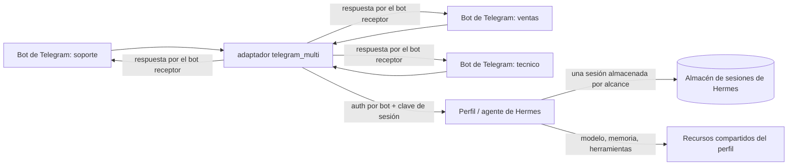

# Multi-Telegram para Hermes Agent

[English](README.md) | **Español**

Ejecuta **muchas identidades de bots de Telegram a través de un solo perfil y
agente de Hermes**.

`multi-telegram` es un plugin de plataforma independiente para Hermes. Registra
una plataforma (`telegram_multi`) y supervisa una conexión PTB de long polling
por cada bot configurado. Cada bot tiene su propia referencia de token,
identidad visible, listas de autorización, prompt de rol y política de sesión.
Las respuestas siempre salen por el bot que recibió el mensaje que las originó,
incluso cuando varios bots están activos a la vez.

El plugin es deliberadamente genérico: **no tiene ids de bots, nombres, datos de
empresa ni roles hardcodeados**. Todo es configuración. El despliegue NovaDesk de
[`examples/`](examples/) es ficticio y solo muestra la forma de una configuración
real.

## Genérico por diseño

El plugin **no incluye bots**. No sabe qué significan "soporte", "ventas" o
"NovaDesk"; esos valores aparecen solo en el ejemplo ficticio. En tiempo de
ejecución lee la lista de bots del operador, descubre cada `@username` con
`getMe`, inicia una aplicación PTB por token, aplica las listas de autorización y
el modo de sesión configurados, y enruta cada respuesta por el bot que recibió el
mensaje.

Todo lo relacionado con el negocio pertenece a la configuración, no al plugin:

- `shared_context` para un resumen breve que todos los bots deben conocer;
- `purpose` / `instructions` para el rol de cada bot;
- `toolsets` / `skills` para especializar capacidades;
- el workspace de Hermes, `SOUL.md`, la memoria o las skills para documentos
  largos.

Un despliegue puede tener un bot o veinte, con cualquier id y cualquier rol. El
trabajo del plugin es el transporte, la autorización, el aislamiento o la
compresión de sesiones y el enrutamiento; el trabajo del operador es la política.

## Por qué existe

Un perfil de Hermes ya puede hablar con un bot de Telegram. Los despliegues
reales suelen necesitar varios puntos de entrada:

- identidades de soporte, ventas e ingeniería para la misma empresa;
- un traspaso compartido entre dos bots, para que el bot técnico ya conozca lo
  que el cliente contó a ventas;
- una identidad de soporte aislada que no pueda ver una conversación privada de
  ventas;
- listas de autorización y mensajes de bienvenida separados por identidad;
- un modelo, memoria y configuración de herramientas compartidos en lugar de
  agentes duplicados.

`multi-telegram` añade esas identidades sin bifurcar Hermes y sin ejecutar un
perfil de Hermes por bot.

## Qué hace

- **Una plataforma, N bots.** `telegram_multi` es una sola plataforma de Hermes
  con un número arbitrario de runtimes PTB supervisados.
- **Enrutamiento exacto de respuestas.** Los ids de mensajes entrantes llevan el
  id del bot como prefijo (`<bot_id>:<telegram_id>`) y se persisten en el origen
  de la sesión. Las respuestas finales, ediciones, medios, estados y avisos de
  error resuelven el transporte correcto. No existe un "último bot activo"
  global.
- **Transcripciones realmente compartidas.** Los bots del mismo `shared_group`
  resuelven la misma clave de sesión de Hermes para el mismo chat/usuario/tema
  externo, por lo que continúan una transcripción real almacenada. Distintos
  usuarios, chats y temas permanecen aislados.
- **Modo aislado.** Un bot en modo `isolated` tiene su propia sesión para cada
  chat/usuario/tema externo.
- **Autorización por bot.** Listas numéricas de usuarios/chats, rechazo de
  remitentes bot, política de mención en grupos y `allow_all_users` opcional.
- **Roles por bot.** `purpose` e `instructions` opcionales se añaden al prompt
  efímero del canal en cada turno.
- **Contexto compartido opcional.** Un texto breve de `shared_context` puede
  compartirse entre todos los bots del despliegue (por ejemplo, un resumen de
  empresa). Está vacío por defecto.
- **Capas opcionales de herramientas/skills.** `toolsets` y `skills` pueden
  limitar o especializar un bot sin crear un segundo agente.
- **Medios.** Las fotos, documentos, audios, voces y videos entrantes
  autorizados se cachean a través de Hermes; se admiten texto y medios salientes,
  ediciones, borrados y escritura.
- **Detalles operativos.** CLI segura para tokens, archivo de estado atómico,
  rutas proactivas persistidas por conversación, deduplicación de updates, bloqueo
  de token por alcance, supervisión de reconexión por bot y enrutamiento que falla
  cerrado.

## Qué no es

- **No** son tres agentes con tres modelos o tres memorias. Los bots comparten el
  modelo, la memoria y las capacidades por defecto del perfil.
- **No** es una frontera de seguridad entre bots. `purpose`/`instructions` son
  guía para el prompt. **Las transcripciones aisladas no aíslan la memoria del
  perfil, `USER.md`, `session_search` ni las herramientas.** Si un bot guarda un
  dato en memoria, otro bot puede leerlo en una sesión distinta. Para aislar de
  forma dura memoria, modelo o secretos, usa **perfiles** de Hermes separados o
  restringe los toolsets de la plataforma.
- No añade webhooks, teclados inline de aclaración/aprobación ni entrega de cron
  fuera de proceso en esta versión.

## Arquitectura



El adaptador es una sola plataforma de Hermes. Cada bot tiene su propia
`Application` PTB, `Bot`, pool HTTP y updater. Los bots comparten el modelo, la
memoria y las herramientas del perfil, pero no necesariamente su transcripción.

### Identidad de sesión

Hermes deriva las claves de sesión de la plataforma, el tipo de chat, el id de
chat, el id de hilo y el id de usuario. El plugin codifica la compartición de la
conversación en el `chat_id` sintético:

```text
aislado: tgmt:i:<bot_id>:<real_chat_id>:<user_id>
compartido: tgmt:s:<shared_group>:<real_chat_id>:<user_id>
```

El id real del chat de Telegram y el id del remitente permanecen dentro del
valor y se decodifican antes de cada llamada a la API. El id de usuario forma
parte del chat sintético incluso cuando el aislamiento global por usuario en
grupos está desactivado. Un tema de foro permanece en `thread_id`.

Por tanto, dos bots compartidos producen la misma clave de sesión para el mismo
chat/usuario/tema externo. Los bots aislados no.

### Enrutamiento de respuestas

Orden de resolución saliente:

1. `chat_id` sintético aislado;
2. prefijo `<bot_id>:` en el id de respuesta/mensaje;
3. metadata explícita en una llamada saliente de confianza;
4. `ContextVar` local del turno;
5. ruta persistida del bot receptor por conversación compartida (envíos
   proactivos);
6. `default_bot` explícito para ids de chat crudos.

Si no se cumple ninguno, el envío falla cerrado. La entrega final, los adjuntos y
los avisos de error del turno están vinculados al origen del evento. Los eventos
de otro bot que llegan mientras una sesión compartida está ocupada se difieren en
lugar de mezclarse con el transporte equivocado.

Los eventos entrantes llevan deliberadamente **cero metadata personalizada**. La
admisión nativa de Hermes 0.23 solo acepta su contrato cerrado de metadata de
WhatsApp y rechaza otras claves con `invalid_params`. El prefijo del id de
mensaje, el chat sintético y el `ContextVar` del turno transportan la identidad
del bot.

## Roles y contexto de empresa

Los roles son configuración normal:

```yaml
extra:
  shared_context: |
    NovaDesk is a fictional helpdesk SaaS.
    Plans: Starter, Growth and Enterprise.
    Support hours: 09:00-18:00 UTC-5.
    Support does not quote prices; sales does not do deep technical diagnosis.

  bots:
    - id: soporte
      purpose: "First-line support and FAQ."
      instructions: |
        Do not quote prices. Summarize technical cases for the technical bot.

    - id: ventas
      purpose: "Commercial qualification and plans."
      instructions: |
        Qualify the need and explain plans/prices from the shared context.

    - id: tecnico
      purpose: "Technical implementation and troubleshooting."
      instructions: |
        Ask for version, logs and reproduction steps. Use the shared transcript.
```

`shared_context` es opcional y está vacío por defecto. Los documentos largos de
empresa pertenecen al workspace de Hermes, `SOUL.md`, la memoria o las skills; el
plugin solo inyecta un resumen breve compartido.

## Modos de sesión

### Aislado

Cada bot tiene su propia transcripción para un chat/usuario/tema externo dado.

### Compartido

Los bots con el mismo `shared_group` continúan una transcripción para el mismo
chat/usuario/tema externo. Esto permite un traspaso real:

1. el cliente habla con `ventas` (Ventas);
2. `ventas` registra el caso;
3. `tecnico` (Técnico) continúa con el mismo historial;
4. `soporte` (Soporte), en modo aislado, no lo ve.

Distintos usuarios, chats, temas y grupos compartidos permanecen separados. Es
una sesión real almacenada, no un resumen solo en memoria.

## Instalación

### Desde el catálogo (cuando la entrada sea aceptada)

```powershell
hermes plugins install multi-telegram
hermes plugins enable multi-telegram --no-allow-tool-override
```

### Desde este repositorio

Resuelve el home de Hermes y copia el directorio del plugin:

```powershell
$home = if ($env:HERMES_HOME) { $env:HERMES_HOME } else { Join-Path $HOME ".hermes" }
$dest = Join-Path $home "plugins\multi-telegram"
New-Item -ItemType Directory -Force $dest | Out-Null
Copy-Item .\* $dest -Recurse -Force

hermes plugins validate $dest --install-deps
hermes plugins doctor $dest --ci
hermes plugins enable multi-telegram --no-allow-tool-override
```

Instala el directorio como `multi-telegram` (o usa el nombre del directorio como
clave del plugin). `plugins.isolation` debe ser `in_process`; los adaptadores de
plataforma no pueden ejecutarse en el proceso `host` aislado.

## Configuración

Añade un bloque de plataforma al `config.yaml` del perfil:

```yaml
gateway:
  platforms:
    telegram_multi:
      enabled: true
      reply_to_mode: first
      extra:
        default_bot: soporte
        shared_context: |
          Optional shared brief for every bot.
        bots:
          - id: soporte
            display_name: "NovaDesk Support"
            token_env: TELEGRAM_MULTI_SOPORTE_TOKEN
            allowed_users: [123456789]
            session_mode: isolated
            group_require_mention: true

          - id: ventas
            display_name: "NovaDesk Sales"
            token_env: TELEGRAM_MULTI_VENTAS_TOKEN
            allowed_users: [123456789]
            session_mode: shared
            shared_group: novadesk

          - id: tecnico
            display_name: "NovaDesk Technical"
            token_env: TELEGRAM_MULTI_TECNICO_TOKEN
            allowed_users: [123456789]
            session_mode: shared
            shared_group: novadesk
```

Pon los tokens en el alcance de secretos del perfil activo (normalmente el
`.env` del perfil):

```dotenv
TELEGRAM_MULTI_SOPORTE_TOKEN=...
TELEGRAM_MULTI_VENTAS_TOKEN=...
TELEGRAM_MULTI_TECNICO_TOKEN=...
```

`display_name` es la etiqueta que se usa en los prompts y en el estado. El
nombre y el `@username` que se ven dentro de Telegram se configuran en BotFather
y son independientes de este valor.

Nunca pongas tokens en `config.yaml`, en el control de versiones, en capturas de
pantalla ni en el chat.

Consulta [`examples/config.multi-bot.yaml`](examples/config.multi-bot.yaml) para
ver un ejemplo completo y ficticio de NovaDesk, y
[`docs/configuration.md`](docs/configuration.md) para todas las claves.

## CLI

```text
hermes multi-telegram status [--json]
hermes multi-telegram validate [--no-tokens] [--network] [--json]
hermes multi-telegram test --bot <id> --chat <numeric-id> [--thread <id>] [--text ...]
hermes multi-telegram test --bot <id> --no-send
```

La CLI muestra nombres de variables de entorno y presencia de tokens, nunca los
valores. `--network` ejecuta un `getMe` real por cada bot habilitado; `test`
envía un mensaje real cuando se proporciona `--chat`.

## Ejecutar y observar

El gateway de Telegram es un proceso separado del TUI local:

```powershell
hermes gateway run -v
```

Útil en otras terminales:

```powershell
hermes multi-telegram status
hermes logs -f
hermes sessions list --source telegram_multi
```

`hermes --tui` es una sesión de chat local con el mismo perfil, no un espejo en
vivo de los turnos de Telegram. El log del gateway y `hermes logs -f` muestran la
actividad de Telegram.

## Escenario de demostración

El repositorio incluye un despliegue ficticio de NovaDesk:

- **Soporte** (`soporte`) está aislado y gestiona las preguntas de primer nivel.
- **Ventas** (`ventas`) y **Técnico** (`tecnico`) comparten
  `shared_group: novadesk`.
- Ventas recibe un código (`VERDE-77`); Técnico puede repetirlo desde la
  transcripción compartida; Soporte no puede verlo.
- El ejemplo restringe cada bot a `toolsets: [web, vision, todo]`. Esto mantiene
  la demo honesta: sin esa restricción, un bot podría guardar el código en la
  memoria persistente del perfil (o buscar en otra sesión) aunque la
  transcripción esté aislada. El plugin no desactiva esas herramientas por ti.
- Los mensajes de grupo requieren una mención (`group_require_mention: true`).
- Los usuarios no autorizados se rechazan antes de ejecutar el agente.

Esto demuestra el valor central del plugin: un solo cerebro de empresa, tres
identidades, traspaso real, aislamiento donde se configura y enrutamiento exacto
de respuestas.

## Seguridad

- Los tokens se leen del alcance de secretos del perfil activo; nunca se
  registran ni se escriben en el estado.
- La redacción del token completo cubre los errores del plugin y un filtro de
  mejor esfuerzo en los logs de PTB/httpx.
- La autorización por bot se ejecuta en el adaptador antes de `handle_message`.
- Un bloqueo por alcance impide que dos instancias del plugin hagan polling del
  mismo token.
- El enrutamiento falla cerrado cuando no puede probarse un transporte.
- Los envíos proactivos en modo compartido usan una ruta persistida por
  conversación o el `default_bot` explícito; no hay un fallback global de último
  bot.
- `allow_all_users` se registra y se muestra en el estado; trata ese bot como
  público.
- Se requiere `plugins.isolation: in_process`.

Consulta [`docs/security.md`](docs/security.md), incluida la advertencia sobre la
puerta de autorización global de DMs y los límites honestos del filtro de logs.

## Pruebas

El repositorio tiene una suite automatizada de unittest que cubre configuración,
autorización, identidad de sesión sintética, claves de sesión reales de Hermes,
objetos PTB entrantes, llamadas PTB salientes, cableado de arranque de PTB,
entrega final concurrente, diferimiento entre bots, redacción de tokens,
persistencia de estado y seguridad de la CLI.

```powershell
python -m compileall -q .
python -m unittest discover -s tests -t . -v
hermes plugins validate . --install-deps
hermes plugins doctor . --ci
```

La validación real con Telegram se documenta en [`VALIDATION.md`](VALIDATION.md).
La suite usa clientes simulados; no sustituye una prueba real de humo.

## Limitaciones

- Solo long polling; los webhooks no están implementados.
- Los teclados inline de aclaración/aprobación no están implementados; se usa el
  fallback de texto.
- La entrega de cron fuera de proceso (`standalone_sender_fn`) no está
  implementada.
- Los mensajes editados, canales, stickers, ubicaciones y contactos no se
  reenvían.
- Las listas de autorización aceptan ids numéricos de Telegram, no usernames.
- `shared_context`, `purpose` e `instructions` son guía para el prompt, no una
  frontera de seguridad dura.
- Las transcripciones aisladas no aíslan la memoria persistente, `USER.md`,
  `session_search` ni las herramientas. Un perfil significa una memoria y un
  conjunto de herramientas por defecto. Usa perfiles separados para cerebros de
  agente separados, o restringe `toolsets` (la demo usa `[web, vision, todo]`).
- Los temas de DM de Telegram (frente a los temas de foro de grupo) no están
  verificados.

## Documentación

- [Instalación](docs/installation.md)
- [Configuración](docs/configuration.md)
- [Modos de sesión y enrutamiento](docs/session-modes.md)
- [Guía de Windows](docs/windows.md)
- [Seguridad](docs/security.md)
- [Arquitectura](docs/architecture.md)
- [Solución de problemas](docs/troubleshooting.md)
- [Validación](VALIDATION.md)
- [Demo simulada](scripts/demo.py)
- [README en inglés](README.md)

## Licencia

MIT. Consulta [LICENSE](LICENSE).
