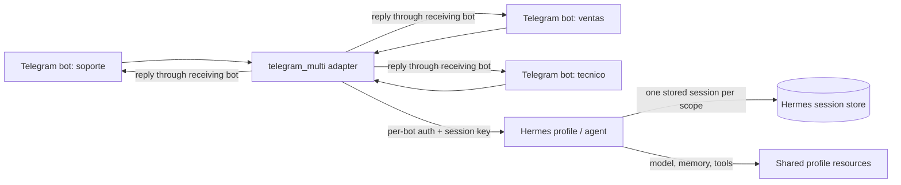

# Multi-Telegram for Hermes Agent

**English** | [Español](README.es.md)

Run **many Telegram bot identities through one Hermes profile and agent**.

`multi-telegram` is a standalone Hermes platform plugin. It registers one
platform (`telegram_multi`) and supervises one long-polling PTB connection per
configured bot. Each bot has its own token reference, display identity,
allowlists, role prompt and session policy. Replies always leave through the bot
that received the triggering message, even when several bots are active at
once.

The plugin is deliberately generic: **no bot ids, names, company data or roles
are hardcoded**. Everything is configuration. The NovaDesk deployment in
[`examples/`](examples/) is fictional and only demonstrates the shape of a real
setup.

## Generic by design

The plugin ships **no bots**. It does not know what "soporte", "ventas" or
"NovaDesk" mean; those values appear only in the fictional example. At runtime
it reads the operator's bot list, discovers each `@username` with `getMe`,
starts one PTB application per token, applies the configured allowlists and
session mode, and routes every reply through the bot that received the
message.

Anything about the business belongs in configuration, not in the plugin:

- `shared_context` for a short brief every bot should know;
- `purpose` / `instructions` for each bot's role;
- `toolsets` / `skills` to specialize capabilities;
- the Hermes workspace, `SOUL.md`, memory or skills for long documents.

A deployment can have one bot or twenty, with any ids and any roles. The
plugin's job is the transport, authorization, session isolation/sharing and
routing; the operator's job is the policy.

## Why this exists

One Hermes profile can already talk to one Telegram bot. Real deployments often
need several entry points:

- support, sales and engineering identities for the same company;
- a shared handoff between two bots, so a technical bot already knows what the
  customer told sales;
- an isolated support identity that cannot see a private sales conversation;
- separate allowlists and welcome messages per identity;
- one shared model, memory and tool configuration instead of duplicate agents.

`multi-telegram` adds those identities without forking Hermes and without
running one Hermes profile per bot.

## What it does

- **One platform, N bots.** `telegram_multi` is a single Hermes platform with an
  arbitrary number of supervised PTB runtimes.
- **Exact reply routing.** Inbound message ids are prefixed with the bot id
  (`<bot_id>:<telegram_id>`) and persisted in the session origin. Final replies,
  edits, media, status and error notices resolve the correct transport. There
  is no process-global "last active bot".
- **Genuine shared transcripts.** Bots in the same `shared_group` resolve to the
  same Hermes session key for the same external chat/user/topic, so they
  continue one real stored transcript. Different users, chats and topics stay
  isolated.
- **Isolated mode.** A bot in `isolated` mode gets its own session for each
  external chat/user/topic.
- **Per-bot authorization.** Numeric user/chat allowlists, bot-sender denial,
  group mention policy, and optional `allow_all_users`.
- **Per-bot roles.** Optional `purpose` and `instructions` are added to the
  ephemeral channel prompt on every turn.
- **Optional shared context.** A short `shared_context` string can be shared by
  every bot in the deployment (for example, a company brief). It is empty by
  default.
- **Optional tool/skill overlays.** `toolsets` and `skills` can narrow or
  specialize a bot without creating a second agent.
- **Media.** Authorized inbound photos, documents, audio, voice and video are
  cached through Hermes; outbound text/media, edits, deletes and typing are
  supported.
- **Operational polish.** Token-safe CLI, atomic status file, persisted
  per-conversation proactive routes, update deduplication, scoped token lock,
  per-bot reconnect supervision and fail-closed routing.

## What it is not

- It is **not** three agents with three models or three memories. Bots share the
  profile's model, memory and default capabilities.
- It is **not** a security boundary between bots. `purpose`/`instructions` are
  prompt guidance. **Isolated transcripts do not isolate profile memory,
  `USER.md`, `session_search` or tools.** If one bot writes a fact to memory,
  another bot can read it in a different session. For hard isolation of memory,
  model or secrets, use separate Hermes **profiles** or restrict the platform's
  toolsets.
- It does not add webhooks, inline clarify/approval keyboards or out-of-process
  cron delivery in this release.

## Architecture



The adapter is one Hermes platform. Each bot has its own PTB `Application`,
`Bot`, HTTP pool and updater. The bots share the profile's model, memory and
tools, but not necessarily their transcript.

### Session identity

Hermes derives session keys from platform, chat type, chat id, thread id and
user id. The plugin encodes conversation sharing in the synthetic `chat_id`:

```text
isolated: tgmt:i:<bot_id>:<real_chat_id>:<user_id>
shared:   tgmt:s:<shared_group>:<real_chat_id>:<user_id>
```

The real Telegram chat id and sender id stay inside the value and are decoded
before every API call. The user id is part of the synthetic chat id even when
global group-per-user isolation is off. A forum topic remains in `thread_id`.

Two shared bots therefore produce the same session key for the same external
chat/user/topic. Isolated bots do not.

### Reply routing

Outbound resolution order:

1. isolated synthetic `chat_id`;
2. `<bot_id>:` reply/message id prefix;
3. explicit metadata on a trusted outbound call;
4. turn-local `ContextVar`;
5. shared per-conversation receiving-bot route (proactive sends);
6. explicit `default_bot` for raw chat ids.

If none applies, the send fails closed. Final delivery, attachments and
turn-error notices are bound to the event source. Cross-bot events that arrive
while a shared session is busy are deferred rather than merged onto the wrong
transport.

Inbound events deliberately carry **no custom metadata**. Hermes 0.23's native
admission accepts only its closed WhatsApp metadata contract and refuses other
keys with `invalid_params`. The message-id prefix, synthetic chat id and
turn-local `ContextVar` carry the bot identity instead.

## Roles and company context

Roles are ordinary configuration:

```yaml
extra:
  shared_context: |
    NovaDesk is a fictional helpdesk SaaS.
    Plans: Starter, Growth and Enterprise.
    Support hours: 09:00-18:00 UTC-5.
    Support does not quote prices; sales does not do deep technical diagnosis.

  bots:
    - id: soporte
      purpose: "First-line support and FAQ."
      instructions: |
        Do not quote prices. Summarize technical cases for the technical bot.

    - id: ventas
      purpose: "Commercial qualification and plans."
      instructions: |
        Qualify the need and explain plans/prices from the shared context.

    - id: tecnico
      purpose: "Technical implementation and troubleshooting."
      instructions: |
        Ask for version, logs and reproduction steps. Use the shared transcript.
```

`shared_context` is optional and empty by default. Long company documents
belong in the Hermes workspace, `SOUL.md`, memory or skills; the plugin only
injects a short shared brief.

## Session modes

### Isolated

Each bot has its own transcript for a given external chat/user/topic.

### Shared

Bots with the same `shared_group` continue one transcript for the same external
chat/user/topic. This enables a real handoff:

1. the customer talks to `ventas` (Sales);
2. `ventas` records the case;
3. `tecnico` (Technical) continues with the same history;
4. `soporte` (Support), in isolated mode, does not see it.

Different users, chats, topics and shared groups remain separate. This is a
real stored session, not a memory-only summary.

## Install

### From the catalog (after the entry is accepted)

```powershell
hermes plugins install multi-telegram
hermes plugins enable multi-telegram --no-allow-tool-override
```

### From this repository

Resolve the Hermes home and copy the plugin directory:

```powershell
$home = if ($env:HERMES_HOME) { $env:HERMES_HOME } else { Join-Path $HOME ".hermes" }
$dest = Join-Path $home "plugins\multi-telegram"
New-Item -ItemType Directory -Force $dest | Out-Null
Copy-Item .\* $dest -Recurse -Force

hermes plugins validate $dest --install-deps
hermes plugins doctor $dest --ci
hermes plugins enable multi-telegram --no-allow-tool-override
```

Install the directory as `multi-telegram` (or use the directory name as the
plugin key). `plugins.isolation` must be `in_process`; platform adapters cannot
run in the isolated `host` process.

## Configure

Add a platform block to the profile `config.yaml`:

```yaml
gateway:
  platforms:
    telegram_multi:
      enabled: true
      reply_to_mode: first
      extra:
        default_bot: soporte
        shared_context: |
          Optional shared brief for every bot.
        bots:
          - id: soporte
            display_name: "NovaDesk Support"
            token_env: TELEGRAM_MULTI_SOPORTE_TOKEN
            allowed_users: [123456789]
            session_mode: isolated
            group_require_mention: true

          - id: ventas
            display_name: "NovaDesk Sales"
            token_env: TELEGRAM_MULTI_VENTAS_TOKEN
            allowed_users: [123456789]
            session_mode: shared
            shared_group: novadesk

          - id: tecnico
            display_name: "NovaDesk Technical"
            token_env: TELEGRAM_MULTI_TECNICO_TOKEN
            allowed_users: [123456789]
            session_mode: shared
            shared_group: novadesk
```

Put tokens in the active profile's secret scope (normally the profile `.env`):

```dotenv
TELEGRAM_MULTI_SOPORTE_TOKEN=...
TELEGRAM_MULTI_VENTAS_TOKEN=...
TELEGRAM_MULTI_TECNICO_TOKEN=...
```

`display_name` is the label used in prompts and status. The name and
`@username` shown inside Telegram are set in BotFather and are independent of
this value.

Never put tokens in `config.yaml`, source control, screenshots or chat.

See [`examples/config.multi-bot.yaml`](examples/config.multi-bot.yaml) for a
complete fictional NovaDesk example, and
[`docs/configuration.md`](docs/configuration.md) for every key.

## CLI

```text
hermes multi-telegram status [--json]
hermes multi-telegram validate [--no-tokens] [--network] [--json]
hermes multi-telegram test --bot <id> --chat <numeric-id> [--thread <id>] [--text ...]
hermes multi-telegram test --bot <id> --no-send
```

The CLI prints environment-variable names and token presence, never token
values. `--network` performs a live `getMe` per enabled bot; `test` sends a real
message when `--chat` is supplied.

## Run and observe

The Telegram gateway is a separate process from the local TUI:

```powershell
hermes gateway run -v
```

Useful in other terminals:

```powershell
hermes multi-telegram status
hermes logs -f
hermes sessions list --source telegram_multi
```

`hermes --tui` is a local chat session with the same profile, not a live mirror
of Telegram turns. The gateway log and `hermes logs -f` show Telegram activity.

## Demo scenario

The repository includes a fictional NovaDesk deployment:

- **Support** (`soporte`) is isolated and handles first-line FAQ.
- **Sales** (`ventas`) and **Technical** (`tecnico`) share
  `shared_group: novadesk`.
- Sales receives a code (`VERDE-77`); Technical can repeat it from the shared
  transcript; Support cannot see it.
- The example restricts every bot to `toolsets: [web, vision, todo]`. This
  keeps the demo honest: without it, a bot could save the code to the profile's
  persistent memory (or search another session) even though the transcript is
  isolated. The plugin does not disable those tools for you.
- Group messages require a mention (`group_require_mention: true`).
- Unauthorized users are denied before the agent runs.

This demonstrates the plugin's core value: one company brain, three identities,
real handoff, isolation where configured, and exact reply routing.

## Security

- Tokens are read from the active profile's secret scope; never logged or
  written to status.
- Whole-token redaction covers plugin errors and a best-effort filter on
  PTB/httpx logs.
- Per-bot authorization runs in the adapter before `handle_message`.
- A scoped lock prevents two plugin instances from polling the same token.
- Routing fails closed when no transport can be proven.
- Shared-mode proactive sends use a persisted per-conversation route or the
  explicit `default_bot`; there is no global last-bot fallback.
- `allow_all_users` is logged and visible in status; treat such a bot as public.
- `plugins.isolation: in_process` is required.

See [`docs/security.md`](docs/security.md), including the platform-wide DM
gate caveat and the honest limits of the log filter.

## Testing

The repository has an automated unittest suite covering configuration,
authorization, synthetic session identity, real Hermes session keys, inbound
PTB objects, outbound PTB calls, PTB startup wiring, concurrent final delivery,
cross-bot deferral, token redaction, status persistence and CLI safety.

```powershell
python -m compileall -q .
python -m unittest discover -s tests -t . -v
hermes plugins validate . --install-deps
hermes plugins doctor . --ci
```

Live Telegram validation is tracked in [`VALIDATION.md`](VALIDATION.md). The
suite uses simulated clients; it is not a substitute for a live smoke test.

## Limitations

- Long polling only; webhooks are not implemented.
- Inline clarify/approval keyboards are not implemented; text fallback is used.
- Out-of-process cron delivery (`standalone_sender_fn`) is not implemented.
- Edited messages, channels, stickers, locations and contacts are not forwarded.
- Allowlists accept numeric Telegram ids, not usernames.
- `shared_context`, `purpose` and `instructions` are prompt guidance, not a hard
  security boundary.
- Isolated transcripts do not isolate persistent memory, `USER.md`,
  `session_search` or tools. One profile means one memory and one default tool
  set. Use separate profiles for separate agent brains, or restrict `toolsets`
  (the demo uses `[web, vision, todo]`).
- Telegram DM topics (as opposed to group forum topics) are unverified.

## Documentation

- [Installation](docs/installation.md)
- [Configuration](docs/configuration.md)
- [Session modes and routing](docs/session-modes.md)
- [Windows guide](docs/windows.md)
- [Security](docs/security.md)
- [Architecture](docs/architecture.md)
- [Troubleshooting](docs/troubleshooting.md)
- [Validation](VALIDATION.md)
- [Simulated demo](scripts/demo.py)
- [README en español](README.es.md)

## License

MIT. See [LICENSE](LICENSE).
